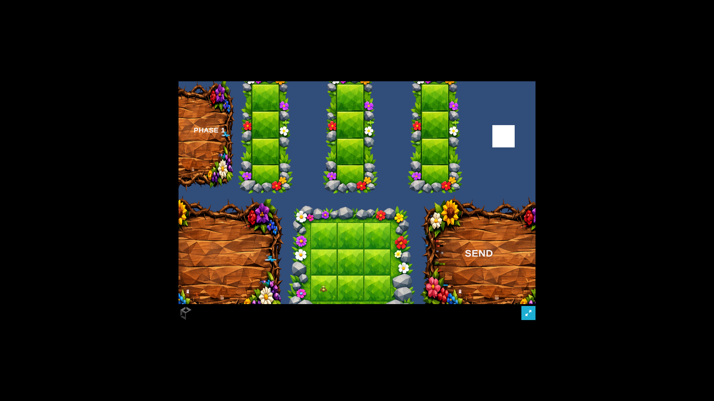
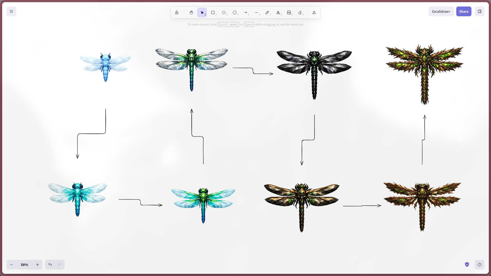
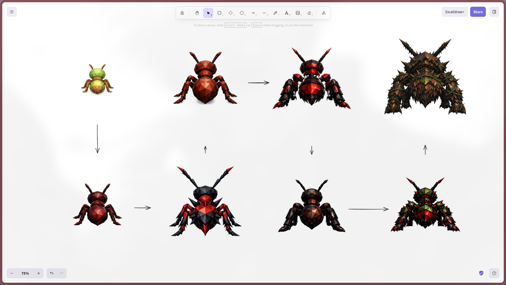

# 🐜 Bug Merge — Game Jam Project

My first-ever game jam project, created over a single weekend for a jam themed **“Bug.”**  
This small Unity game mixes **merging mechanics**, **light strategy**, and **risk management**, featuring **ants** and **dragonflies** as your main units.

---

## 🖼️ Images

---

## 🎮 Gameplay Overview

At the start of each round, you receive a **level 1 ant**.  
You must then distribute your insects across **three different paths**, choosing at least one and up to all three.

Each path can be one of the following:

- **Trap** — All insects sent here are lost.
- **Battle** — If your insects’ combined level is lower than the enemy’s, you lose them. Otherwise, you defeat the enemy.
- **Chest** — Contains a bug.
  - If your insect’s level is higher than the bug’s, you rescue and recruit it.
  - Otherwise, you simply keep your own insect.

Between rounds, you can **merge two insects of the same type** to create a stronger, higher‑level version.

Your goal is simple: **survive and progress as far as possible.**

---

## 🛠️ Development

This project was built entirely over a single weekend, focusing on implementing the core gameplay rather than polishing visuals or UI.  
It was developed using:

- **Unity**
- **C#**
- Quick prototype assets and simple visuals

---

## 📦 Features

- Merge system for ants and dragonflies
- Randomized paths each round
- Risk–reward decision-making
- Simple progression loop
- Lightweight prototype visuals

---

## 🚧 Limitations

Since this was a game jam project, several aspects are intentionally minimal:

- Basic UI and animations
- Limited balancing
- No sound design
- No save system

The focus was purely on **gameplay experimentation**.

---

## 📜 License

This project is shared for learning and inspiration.  
Feel free to explore the code, mechanics, and structure.
